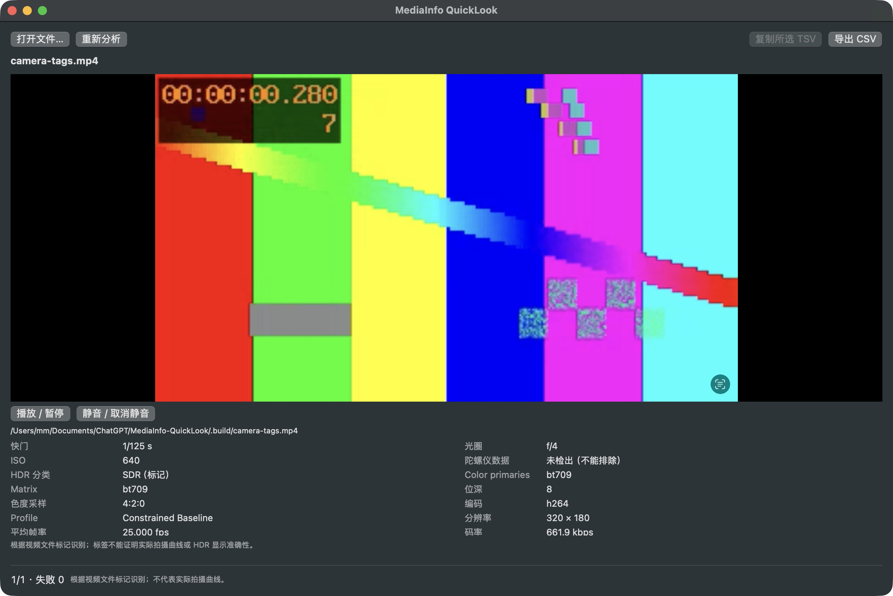
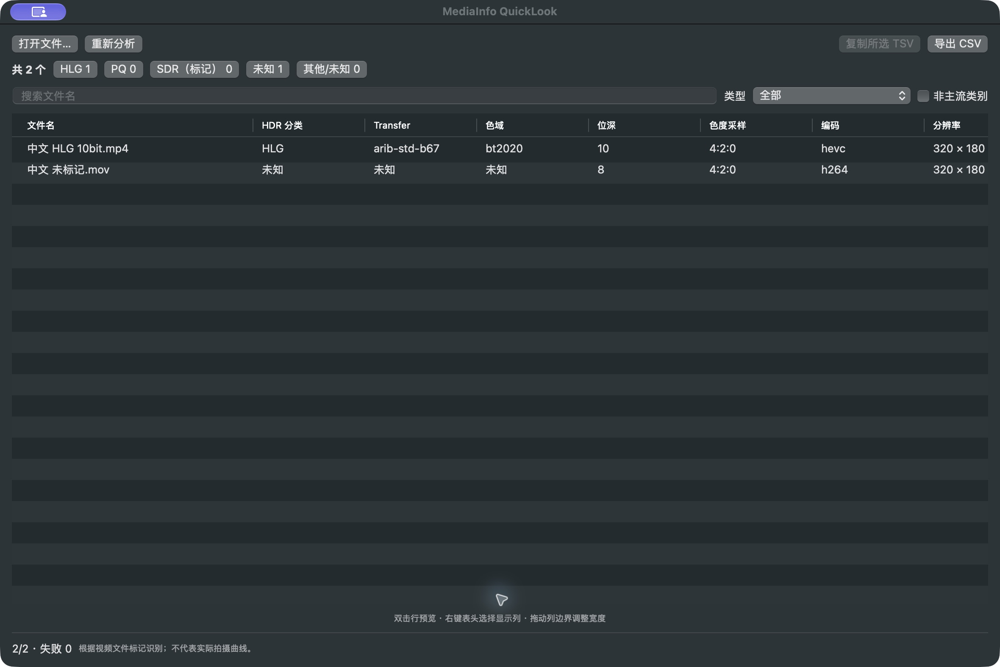

# MediaInfo QuickLook

原生 macOS 菜单栏视频检查工具，面向 Finder 中的 MP4 / MOV 素材。根据**视频流 transfer 标签**识别 HLG、PQ、SDR（标记）、未知/其他；不猜测 Sony S-Log、Nikon N-Log 或实际拍摄历史。系统 `Space` Quick Look 保留原样。

当前交付：**0.2.1 开发版**，已有实际运行的 Apple Silicon `.app`。不是已公证的正式发行版。功能和测试边界见 [测试结果](docs/TEST-RESULTS.md) 与 [验收清单](docs/ACCEPTANCE.md)。

## 界面示例

以下为真实运行窗口，素材由测试脚本合成；截图不构成 HDR 色彩校准证据。





## 安装与首次使用

最低目标 macOS 13；本次实际测试为 macOS 27.0.1 / Apple Silicon。GitHub CI 已在 macOS 15.7.9 上通过 arm64/Intel 构建、XCTest 与媒体集成测试；macOS 13 和 Intel 完整桌面交互尚未实测。

1. 本机测试包为 `dist/MediaInfo-QuickLook-macOS.zip`；另提供 CI 构建的 `-arm64.zip`（Apple Silicon）与 `-x86_64.zip`（Intel），选择对应架构。解压后，将 `MediaInfo QuickLook.app` 拖到“应用程序”。也可直接运行 `dist` 中的应用。
2. 安装可信来源的 `ffprobe`。已有 Homebrew 时运行 `brew install ffmpeg`。应用自动查找 `/opt/homebrew/bin/ffprobe`、`/usr/local/bin/ffprobe`；其他位置在菜单栏 → 设置中选择。**没有内置 ffprobe，也不会替你下载或执行安装器。**
3. 启动后点击菜单栏胶片图标 → 打开窗口；选择“打开文件…”或把视频拖入窗口。
4. 从 Finder 触发：保持 Finder 在前台并选择视频，按 `Option+Space`。首次允许应用控制 Finder；若拒绝，可继续使用打开文件或拖放入口。权限设置位于“系统设置 → 隐私与安全性 → 自动化 → MediaInfo QuickLook → Finder”。
5. 若需读取更多相机拍摄参数，安装可选的 ExifTool：`brew install exiftool`。应用自动查找 Homebrew 路径，也可在设置中指定其他可信可执行文件。改变工具路径后点击“重新分析”。
6. 设置中可修改修饰键/按键组合、工具路径、自动播放、2–4 并发与 CSV BOM；点击“应用快捷键”完成注册。菜单栏可停用热键、暂停增强预览或退出。

`Option+Space` 同时是 Finder 的原生全屏预览组合。Carbon 注册能报告注册层面的冲突，但不能证明所有应用内或系统保留组合都能被替代；若仍进入系统全屏预览，请改用 `Control+Option+Space` 等组合。普通 `Space` 从未注册或拦截。本地 ad-hoc 开发签名在重新构建、移动后可能需要重新授权；不能以开发签名替代 Developer ID 公证。

## 使用

- **单文件**：播放器优先占据高度，下方信息区压缩为原先约 2/5，内容可滚动。预览默认自动播放，在设置中关闭“预览视频自动播放”后保持暂停，偏好在重启后保留；手动播放不受影响。原生 AVPlayerView 支持播放、暂停、静音和进度拖动；展示 HDR 分类、primaries、matrix、位深、色度采样、编码、profile、宽高、帧率、码率、时长、容器、文件大小、相机字段（存在时）。已移除原始像素格式、原始平均/标称帧率、原始 Transfer、拍摄参数来源和说明。时长保留秒后一位小数；码率自动切换 bps/kbps/Mbps/Gbps，文件大小使用 1000 进制 B/KB/MB/GB，最多一位小数；批量排序使用未舍入数值。播放失败不会阻止元数据展示。
- **拍摄参数**：单文件信息区顶部显示快门、光圈、ISO、陀螺仪数据检测结果，CSV/TSV 同步包含这四列，共 23 列，不导出拍摄参数来源和说明。ffprobe 读取公开标签，ExifTool 补充支持的厂商/时序元数据；未安装时基础预览照常工作。存在多个已解析值时标记“变化”，不冒充全片固定拍摄值。
- **批量**：先显示文件名，再增量填充元数据；每个文件独立失败。点表头排序（数值列按数值排序），搜索文件名，按 HDR 分类筛选，查看各类数量。“非主流类别”只表示与数量最多类别不同，不等于故障；并列时按固定类别顺序选择参考类别。
- 双击行预览，返回列表保留排序、筛选、选择和滚动位置。单文件页有切换视频菜单。`Esc` 从批量中的单文件页返回列表，再次按关闭窗口；单独打开一项时直接关闭。
- 右键表头选择显示列，拖动列边界调整宽度；列宽、列显隐、排序、HDR 筛选和窗口位置持久化。
- “复制所选 TSV”复制当前筛选结果中选中的行；“导出 CSV”导出当前筛选/排序后的所有可见行，包含表头。CSV 默认 UTF-8 BOM，设置中可关闭。路径、引号、逗号、换行均进行转义。
- “取消”或关闭窗口取消剩余分析并终止 ffprobe；“重新分析”清缓存并重扫当前选集。设置中可单独清缓存。
- 支持 MP4/MOV/M4V；混选目录、图片和其他扩展名会汇总跳过。损坏视频作为失败行保留。

元数据和缓存均保存在本机，不上传任何文件；不改写视频或视频时间戳。缓存位于 `~/Library/Application Support/MediaInfoQuickLook/metadata-cache-v3.json`，包含已分析路径与参数，键使用规范化路径、文件大小与修改时间；文件变更会失效；更换或安装分析工具后，旧工具上下文的缓存也不会复用。

## 拍摄参数与陀螺仪识别边界

- 只展示文件可解析的拍摄字段；缺失值为未知，不根据帧率推测快门，也不把曝光 APEX 原始值当秒数。ExifTool 以格式化 ExposureTime/FNumber 输出读取。
- 陀螺仪只有在识别到具体采样字段（如 Gyroscope、AngularVelocity、GyroYPR）时显示“有”；明确的存在/不存在标签另标为“文件标记”。普通 rtmd/gpmd 流、加速度计或防抖开关不足以证明陀螺仪存在。
- **未检出不等于没有**：Sony/Nikon 等机型可能使用当前工具尚未解析的私有陀螺仪数据。本版没有实现通用的厂商陀螺仪解码器，不等同于 Gyroflow 的支持矩阵。
- 补充元数据读取使用 `-ee`，长片可能增加扫描耗时；独立超时、取消和有限并发仍生效。失败时保留基础视频参数，缺失的拍摄值显示未知。两个外部工具分别默认超时 20 秒。
- 用户已确认原片与 HDR 显示验证通过；本轮另在一段 Nikon Z6 III MOV 上核对了 ExifTool 与界面显示一致。详细范围见 [0.2.0 验证记录](docs/PREVIEW-CAMERA-VERIFICATION.md)。

## 构建

源码使用 Swift 5 语言模式，Swift 5.9+ 工具链。UI 为 SwiftUI + AppKit，播放为 AVFoundation/AVKit，热键为 Carbon 注册式 API，Finder 为结构化 Apple Events。应用**不启用 App Sandbox**，使用 hardened runtime 与 Automation entitlement；不存在“任意 ffprobe 可在沙盒中直接运行”的假设。

### 完整 Xcode

直接打开 `MediaInfoQuickLook.xcodeproj`，选择共享 scheme `MediaInfoQuickLook`，Run。工程包含 app、Core framework、XCTest targets 和 Debug/Release 配置。

```sh
xcodebuild -project MediaInfoQuickLook.xcodeproj -scheme MediaInfoQuickLook -configuration Debug -derivedDataPath DerivedData build
xcodebuild -project MediaInfoQuickLook.xcodeproj -scheme MediaInfoQuickLook -destination 'platform=macOS' test
```

工程已提交，无需 XcodeGen 或第三方生成工具。新增源码后可运行 `python3 scripts/generate-xcode-project.py` 重新生成，输出确定且仅依赖 Python 标准库。Xcode 生成的产品名为 `MediaInfoQuickLook.app`，显示名为 MediaInfo QuickLook。

### 只有 Command Line Tools

```sh
scripts/build-app.sh debug
scripts/build-app.sh release
open 'dist/MediaInfo QuickLook.app' --args --show
```

产物为 `dist/MediaInfo QuickLook.app` 和 `dist/MediaInfo-QuickLook-macOS.zip`。默认使用本地 ad-hoc 签名。脚本按当前架构构建；本次交付 ZIP 为 arm64。无完整 Xcode 时仍可构建运行应用，但 `swift test` 可能因没有 XCTest SDK 失败。

## 测试

```sh
scripts/check.sh
# 完整 Xcode 工具链还可运行：
swift test
```

`check.sh` 实际编译并运行独立 Swift 断言程序，生成 HLG/PQ/SDR/未知测试视频、200 个文件副本及损坏文件，验证解析、导出、缓存、超时/取消、AVPlayer 播放时钟与应用扫描模型。需要 ffmpeg/ffprobe；安装 ExifTool 后也执行真实补充元数据读取测试。`FFMPEG`、`FFPROBE`、`EXIFTOOL` 可覆盖测试二进制路径。合成素材位于 `.build/fixtures`；测试会更新这一区域，并清理应用元数据缓存，不修改用户素材。合成测试不能代替 Sony/Nikon 原片与 HDR 显示验收。

本轮显示精简、单位与排序验证见 [0.2.1 验证记录](docs/DISPLAY-VERIFICATION.md)。

详细执行证据：[核心测试](docs/CORE-VERIFICATION.md)、[系统集成](docs/PLATFORM-VERIFICATION.md)、[本次交付结果](docs/TEST-RESULTS.md)。

## 持续集成

[macOS 构建与测试](https://github.com/hemafri/MediaInfo-QuickLook/actions/workflows/macos.yml) 在 Apple Silicon 与 Intel macOS runner 上分别执行 Xcode Debug/XCTest、Xcode Release、Swift Package XCTest 和合成媒体集成检查。推送代码和 Pull Request 自动触发，也可手动运行。每次保存工具链版本、测试日志、xcresult 以及对应架构的 ad-hoc 开发包，保留 14 天。下载 Actions 产物需要登录 GitHub。

首次双架构运行已通过，具体版本、测试结果及包校验和见 [CI 验证记录](docs/CI-VERIFICATION.md)。

CI 使用合成素材，不读取或上传用户视频；不能替代 Finder/TCC、HDR 显示及相机原片验收。ZIP 仍需另行配置 ffprobe；扩展相机字段使用可选 ExifTool。

## 发布准备

本次 ZIP 不包含第三方 ffprobe，避免对未核验构建进行再分发。若未来内置，需审查实际 ffprobe 构建配置、许可证、对应源码/声明以及签名，而不是仅凭工具名称推断许可。

拥有 Developer ID 证书后，可通过 `CODE_SIGN_IDENTITY='Developer ID Application: …' scripts/build-app.sh release` 签名，再执行 `xcrun notarytool submit dist/MediaInfo-QuickLook-macOS.zip --keychain-profile <profile> --wait`；成功后 `xcrun stapler staple 'dist/MediaInfo QuickLook.app'` 并重新生成 ZIP。本次未具备可用发布证书，**未执行公证**。不要将本地签名验证误写成 Gatekeeper 发行验证。
